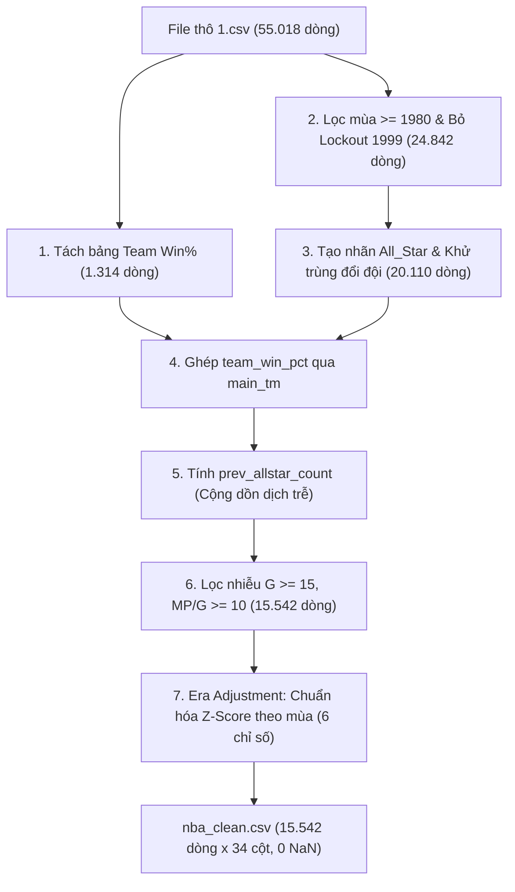

# CẨM NANG TOÀN TẬP VỀ DỰ ÁN DỰ ĐOÁN NBA ALL-STAR (NBA ALL-STAR PREDICTION)

> **Mục tiêu tài liệu:** Cung cấp bức tranh toàn cảnh cặn kẽ, sâu sắc nhất về toàn bộ logic nghiệp vụ, kỹ thuật tiền xử lý dữ liệu, thiết kế đặc trưng, chiến lược huấn luyện mô hình học máy, cách thức đánh giá Top-$k$, và giải mã chi tiết kết quả dự đoán qua các mùa giải gần đây (2024, 2025, 2026).

---

## MỤC LỤC
1. [Bản chất bài toán & Cơ chế tuyển chọn NBA All-Star](#1-bản-chất-bài-toán--cơ-chế-tuyển-chọn-nba-all-star)
2. [Cơ chế chọn cầu thủ: Ngưỡng xác suất (Threshold) vs. Xếp hạng Top-K](#2-cơ-chế-chọn-cầu-thủ-ngưỡng-xác-suất-threshold-vs-xếp-hạng-top-k)
3. [Quy trình tiền xử lý dữ liệu thực tế (`1.csv` $\rightarrow$ `nba_clean.csv`)](#3-quy-trình-tiền-xử-lý-dữ-liệu-thực-tế)
4. [Không gian đặc trưng (Feature Space - 24 Features)](#4-không-gian-đặc-trưng-feature-space)
5. [Thiết kế & Huấn luyện 4 Mô hình Học máy](#5-thiết-kế--huấn-luyện-4-mô-hình-học-máy)
6. [Phương pháp Đánh giá Hiệu năng Toàn diện](#6-phương-pháp-đánh-giá-hiệu-năng-toàn-diện)
7. [Phân tích chuyên sâu Kết quả các mùa 2024, 2025, 2026 & Error Analysis](#7-phân-tích-chuyên-sâu-kết-quả-các-mùa-2024-2025-2026)
8. [Hướng dẫn vận hành & Kiểm tra thực tế](#8-hướng-dẫn-vận-hành--kiểm-tra-thực-tế)

---

## 1. BẢN CHẤT BÀI TOÁN & CƠ CHẾ TUYỂN CHỌN NBA ALL-STAR

### 1.1. Sự kiện NBA All-Star là gì?
Hằng năm vào giữa tháng 2, giải bóng rổ nhà nghề Mỹ (NBA) tổ chức trận đấu **All-Star Game** quy tụ những ngôi sao xuất sắc nhất giải đấu. 

### 1.2. Thể thức tuyển chọn thực tế ngoài đời
Một đội hình All-Star tiêu chuẩn gồm **24 cầu thủ** (12 miền Đông - East, 12 miền Tây - West):
1. **10 cầu thủ xuất phát (Starters - 5 East, 5 West):** Được bình chọn theo công thức tính điểm trọng số:
   $$\text{Điểm bầu chọn} = 50\% \text{ Người hâm mộ (Fan)} + 25\% \text{ Cầu thủ NBA} + 25\% \text{ Giới truyền thông (Media)}$$
2. **14 cầu thủ dự bị (Reserves - 7 East, 7 West):** Do toàn bộ **30 Huấn luyện viên trưởng (Head Coaches)** của các đội bóng tại NBA bỏ phiếu kín.
3. **Suất thay thế chấn thương (Injury Replacements):** Nếu bất kỳ cầu thủ nào trong danh sách 24 người bị chấn thương trước trận đấu, **Ủy viên ban điều hành NBA (Commissioner)** sẽ tự tay chỉ định một cầu thủ khác thay thế. 
   - *Hệ quả thực tế:* Tổng số cầu thủ được gắn mác All-Star trong mùa giải đó sẽ tăng lên thành **26, 27 hoặc 28 cầu thủ** thay vì con số 24 ban đầu!

### 1.3. Những thách thức cốt lõi đối với Machine Learning
- **Mất cân bằng lớp nghiêm trọng (Severe Class Imbalance):** Trong mỗi mùa giải có khoảng 500 cầu thủ thi đấu, nhưng chỉ có $\approx 24 - 28$ người được chọn. Tỷ lệ lớp dương ($y=1$) chỉ chiếm **~7.58%**, trong khi lớp âm ($y=0$) chiếm tới **92.42%**.
- **Yếu tố danh tiếng & Quán tính lịch sử:** Các siêu sao lớn (LeBron James, Stephen Curry, Kevin Durant) dù phong độ có giảm sút đôi chút hay đội bóng thi đấu sa sút vẫn luôn nhận được lượng phiếu khổng lồ từ fan hâm mộ toàn cầu.
- **Sự khác biệt kỷ nguyên (Era Drift / Pace Shift):** Vào những năm 1990–2000, nhịp độ trận đấu chậm (Pace ~90), một cầu thủ ghi 20 điểm/trận đã là ngôi sao hàng đầu. Nhưng đến giai đoạn 2020–2026, lối chơi ném 3 điểm bùng nổ đẩy Pace lên trên 100, mức 20 điểm/trận trở nên rất phổ biến. Nếu đưa chỉ số thô vào mô hình mà không chuẩn hóa, mô hình sẽ bị thiên vị cho các cầu thủ thời hiện đại.

---

## 2. CƠ CHẾ CHỌN CẦU THỦ: NGƯỠNG XÁC SUẤT (THRESHOLD) VS. XẾP HẠNG TOP-K

Đây là câu hỏi quan trọng nhất về mặt phương pháp luận trong bài toán này: **Mô hình chọn đúng 26 người hay chọn nhiều hơn?**

Trong Machine Learning cho bài toán này, chúng ta sử dụng song song **2 cơ chế ra quyết định**:

```
                              [ĐẦU RA CỦA MÔ HÌNH: y_proba]
                                           |
         ---------------------------------------------------------------------
         |                                                                   |
   [CƠ CHẾ 1: THRESHOLD (Ngưỡng 0.5)]                         [CƠ CHẾ 2: RANKING TOP-K]
         |                                                                   |
• Logic: Ai có y_proba >= 0.5 thì dự đoán = 1                • Logic: Xếp hạng toàn bộ cầu thủ trong mùa
• Số lượng được chọn: KHÔNG CỐ ĐỊNH                           theo y_proba từ cao xuống thấp.
  (Có thể là 18, 25, 32 hoặc 40 người).                      • Lấy ĐÚNG k người đầu bảng (k = số All-Star
• Mục đích: Đánh giá khả năng phân loại tổng quát              thực tế của năm đó: 26 người năm 2024,
  (Precision, Recall, F1, PR-AUC).                             26 người năm 2025, 28 người năm 2026).
                                                             • Mục đích: MÔ PHỎNG CHÍNH XÁC DANH SÁCH TUYỂN
                                                               CHỌN CỐ ĐỊNH CỦA NBA.
```

### So sánh chi tiết 2 cơ chế:

| Đặc điểm | Cơ chế 1: Ngưỡng xác suất (`Threshold = 0.5`) | Cơ chế 2: Xếp hạng Top-$k$ (`Top-K Accuracy`) |
| :--- | :--- | :--- |
| **Bản chất** | Phân loại nhị phân độc lập từng người (Point-wise Classification). | Xếp hạng danh sách theo mùa (Learning-to-Rank / List-wise). |
| **Số lượng chọn** | **Biến thiên**: Tùy thuộc vào mức độ tự tin của mô hình (ví dụ có năm ra 33 người có xác suất $\ge 0.5$). | **CỐ ĐỊNH ĐÚNG $k$ NGƯỜI**: Nếu mùa 2024 có 26 All-Star ngoài đời $\rightarrow$ mô hình chọn **đúng 26 người có xác suất cao nhất**. |
| **Ý nghĩa thể thao** | Trả lời câu hỏi: *"Cầu thủ này có đủ tố chất All-Star hay không?"* | Trả lời câu hỏi: *"Nếu chỉ có đúng 26 chiếc vé, ai sẽ là người giành được vé?"* |
| **Chỉ số đo lường** | Precision, Recall, F1-Score, PR-AUC, ROC-AUC. | **Top-$k$ Hit Rate** = $\frac{\text{Số All-Star thực tế nằm trong Top } k}{k}$. |

> [!IMPORTANT]
> Khi xem xét kết quả năm 2024, 2025 và 2026: Hệ thống đã áp dụng **Cơ chế 2 (Top-$k$)**:
> - Năm 2024: Lấy **đúng 26 người** điểm cao nhất $\rightarrow$ trúng **19 người** (73.08%).
> - Năm 2025: Lấy **đúng 26 người** điểm cao nhất $\rightarrow$ trúng **22 người** (84.62%).
> - Năm 2026: Lấy **đúng 28 người** điểm cao nhất $\rightarrow$ trúng **24 người** (85.71%).

---

## 3. QUY TRÌNH TIỀN XỬ LÝ DỮ LIỆU THỰC TẾ

Từ file gốc `data/raw/1.csv` ($55.018$ dòng $\times$ $409$ cột), pipeline thực hiện 7 bước kỹ thuật chuẩn hóa để tạo ra `data/processed/nba_clean.csv` ($15.542$ dòng $\times$ $34$ cột, **0 giá trị NaN**):



### Chi tiết 7 bước tiền xử lý:

1. **Trích xuất tỷ lệ thắng đội bóng (`team_win_pct`):**
   - File `1.csv` chứa cả dòng thống kê đội bóng (dòng có `player_id` là null nhưng có `abbreviation` và số trận thắng `w`, thua `l`).
   - Tính: $\text{team\_win\_pct} = \frac{w}{w + l}$.
2. **Lọc kỷ nguyên hiện đại ($\ge 1980$) & Loại bỏ mùa Lockout 1999:**
   - Năm 1980 là thời điểm NBA chính thức đưa vạch ném 3 điểm vào thi đấu.
   - Mùa giải 1998–1999 (mùa 1999) xảy ra đình công (Lockout), trận All-Star bị hủy bỏ hoàn toàn (0 All-Star). Bắt buộc phải loại mùa này để mô hình không học sai rằng các siêu sao năm 1999 bị trượt All-Star.
3. **Tạo nhãn mục tiêu `All_Star` & Xử lý cầu thủ đổi đội giữa mùa (Trade Deduplication):**
   - Nhãn $y=1$ nếu cầu thủ có `replaced.notnull()` (được chọn thay thế) HOẶC `IS_ALLSTAR == 1.0`.
   - Cầu thủ đổi đội có nhiều dòng thống kê (ví dụ: dòng đội cũ, dòng đội mới, và dòng tổng `TOT`, `2TM`, `3TM`). Hệ thống ưu tiên giữ dòng tổng để mỗi cặp `(player_id, season)` là duy nhất, đồng thời tìm đội bóng mà cầu thủ đó thi đấu nhiều trận nhất (`main_tm`) để ghép đúng tỷ lệ thắng.
4. **Bảo toàn danh tiếng quá khứ (`prev_allstar_count`):**
   - Tính bằng: `players.groupby('player_id')['All_Star'].transform(lambda x: x.cumsum().shift(1).fillna(0))`.
   - **Cực kỳ quan trọng:** Bước này được thực hiện **TRƯỚC KHI** lọc nhiễu, đảm bảo một siêu sao nghỉ chấn thương 1 năm không bị mất lịch sử danh tiếng ở các năm tiếp theo.
5. **Lọc mẫu nhiễu ($G \ge 15$ trận, $MP/G \ge 10.0$ phút/trận):**
   - Loại bỏ các cầu thủ dự bị vào sân 1–2 phút làm nhiễu dữ liệu.
   - **Phát hiện 4 ngoại lệ lịch sử:** Loại bỏ đúng 4 trường hợp chấn thương nặng nghỉ gần hết mùa nhưng vẫn được fan bầu chọn làm kỷ niệm:
     1. Kobe Bryant (2014) - chỉ đá 6 trận.
     2. Yao Ming (2011) - chỉ đá 5 trận.
     3. Grant Hill (2001) - chỉ đá 4 trận.
     4. Alonzo Mourning (2001) - chỉ đá 13 trận.
6. **Xử lý giá trị khuyết (Missing Values):**
   - Điền `0.0` cho các tỷ lệ ném rổ (`fg_percent`, `x3p_percent`, `ft_percent`, `ts_percent`). Logic thể thao: Cầu thủ không ném quả nào trong mùa thì tỷ lệ thành công là 0%.
7. **Chuẩn hóa Z-Score theo từng mùa giải (Era Adjustment):**
   - Áp dụng cho 6 chỉ số: `pts_per_game`, `ast_per_game`, `trb_per_game`, `per`, `ws`, `vorp`.
   - Công thức trong nội bộ mùa giải:
     $$Z_{i, \text{season}} = \frac{X_{i, \text{season}} - \mu_{\text{season}}}{\sigma_{\text{season}}}$$
   - Giúp triệt tiêu hoàn toàn sự chênh lệch nhịp độ thi đấu giữa thập niên 1980, 2000 và 2020.

---

## 4. KHÔNG GIAN ĐẶC TRƯNG (FEATURE SPACE - 24 FEATURES)

Dữ liệu đưa vào mô hình học máy gồm **24 đặc trưng số liệu** thuộc 4 nhóm:

| Nhóm đặc trưng | Tên cột đặc trưng | Ý nghĩa chuyên môn bóng rổ | Hệ số tương quan ($r$) với All_Star |
| :--- | :--- | :--- | :---: |
| **1. Chỉ số cá nhân cơ bản (Box-score)** | `pts_per_game`<br>`trb_per_game`<br>`ast_per_game`<br>`stl_per_game`<br>`blk_per_game`<br>`tov_per_game`<br>`mp_per_game` | Điểm số mỗi trận (PTS)<br>Bắt bóng bật bảng (Rebounds)<br>Kiến tạo mỗi trận (Assists)<br>Cướp bóng (Steals)<br>Chắn bóng (Blocks)<br>Mất bóng (Turnovers)<br>Số phút thi đấu/trận | $+0.56$<br>$+0.35$<br>$+0.37$<br>$+0.28$<br>$+0.25$<br>$+0.41$<br>$+0.42$ |
| **2. Hiệu suất ném & Thống kê nâng cao** | `fg_percent`<br>`x3p_percent`<br>`ft_percent`<br>`ts_percent`<br>`per`<br>`usg_percent`<br>`ws`<br>`bpm`<br>`vorp` | Tỷ lệ ném rổ tổng thể<br>Tỷ lệ ném 3 điểm<br>Tỷ lệ ném phạt<br>True Shooting % (Hiệu suất ném quy đổi)<br>Player Efficiency Rating<br>Usage Rate (% giữ bóng tấn công)<br>**Win Shares (Đóng góp số trận thắng)**<br>Box Plus/Minus<br>**Value Over Replacement Player** | $+0.04$<br>$+0.05$<br>$+0.12$<br>$+0.21$<br>$+0.52$<br>$+0.48$<br>**$+0.58$**<br>$+0.51$<br>**$+0.64$** |
| **3. Chuẩn hóa theo thời kỳ (Season Z-Scores)** | `pts_per_game_zscore`<br>`ast_per_game_zscore`<br>`trb_per_game_zscore`<br>`per_zscore`<br>`ws_zscore`<br>`vorp_zscore` | Điểm số chuẩn hóa theo mùa<br>Kiến tạo chuẩn hóa theo mùa<br>Rebounds chuẩn hóa theo mùa<br>PER chuẩn hóa theo mùa<br>Win Shares chuẩn hóa theo mùa<br>VORP chuẩn hóa theo mùa | Dải phân vị (IQR) của nhóm All-Star luôn nằm cao hơn **$+1.5$ đến $+2.5$ độ lệch chuẩn** so với toàn giải đấu trong mùa đó. |
| **4. Bối cảnh đội bóng & Danh tiếng** | `team_win_pct`<br>`prev_allstar_count` | Tỷ lệ thắng của đội bóng chủ quản<br>**Số lần từng vào All-Star trong quá khứ** | $+0.22$<br>**$+0.45$** |

> [!NOTE]
> **Phát hiện thú vị từ phân tích EDA:** Hai chỉ số nâng cao **`vorp` ($r=0.64$)** và **`ws` ($r=0.58$)** có độ tương quan với nhãn All-Star cao hơn cả điểm số trung bình `pts_per_game` ($r=0.56$). Điều này chứng minh các huấn luyện viên và giới chuyên môn đánh giá rất cao hiệu quả đóng góp thực tế vào chiến thắng thay vì chỉ nhìn vào điểm số ghi được.

---

## 5. THIẾT KẾ & HUẤN LUYỆN 4 MÔ HÌNH HỌC MÁY

### 5.1. Phân chia tập dữ liệu theo thứ tự thời gian (Temporal Split)
Để chống hiện tượng **rò rỉ dữ liệu (Data Leakage)**, không dùng `train_test_split` ngẫu nhiên mà chia chặt chẽ theo mốc mùa giải:
- **Tập Train ($\le 2016$):** $11.473$ dòng ($912$ All-Stars, tỷ lệ $7.95\%$) — Dùng để huấn luyện trọng số mô hình.
- **Tập Validation ($2017 - 2019$):** $1.187$ dòng ($80$ All-Stars, tỷ lệ $6.74\%$) — Dùng để tinh chỉnh siêu tham số và chọn mô hình tối ưu.
- **Tập Test ($\ge 2020 - 2026$):** $2.882$ dòng ($186$ All-Stars, tỷ lệ $6.45\%$) — Dùng để kiểm thử mù độc lập hiệu năng dự báo tương lai.

### 5.2. Khung 4 mô hình triển khai (`src/train.py`)
1. **`DummyClassifier(strategy='prior')`:** 
   - Mô hình đối chứng ngẫu nhiên theo phân phối tiên nghiệm của nhãn. Dùng làm thang chuẩn đáy (Baseline floor) để chứng minh các mô hình máy học thực sự có học được quy luật.
2. **`LogisticRegression(class_weight='balanced', max_iter=1000, random_state=42)`:**
   - Mô hình tuyến tính cổ điển, sử dụng hàm Sigmoid:
     $$P(y=1|\mathbf{x}) = \frac{1}{1 + e^{-(\mathbf{w}^T\mathbf{x} + b)}}$$
   - Tham số `class_weight='balanced'` tự động nhân trọng số phạt cao gấp ~12 lần cho lớp All-Star để chống việc mô hình luôn đoán là 0.
3. **`RandomForestClassifier(class_weight='balanced', random_state=42)`:**
   - Tập hợp 100 cây quyết định (Bagging Ensemble). Có khả năng bắt được các mối quan hệ phi tuyến phức tạp (ví dụ: một cầu thủ ghi ít điểm nhưng nếu VORP cực cao và đội thắng nhiều thì vẫn có xác suất cao).
4. **`HistGradientBoostingClassifier(random_state=42)`:**
   - Thuật toán Gradient Boosting dựa trên Histogram (tương tự LightGBM), chia các đặc trưng liên tục thành 256 bins nguyên số. Tốc độ huấn luyện cực nhanh, xử lý tốt ngoại lai và có khả năng nội suy xác suất mượt mà nhất.

---

## 6. PHƯƠNG PHÁP ĐÁNH GIÁ HIỆU NĂNG TOÀN DIỆN

### 6.1. Bảng xếp hạng Benchmark trên Tập Validation ($2017 - 2019$)
*(Đánh giá với ngưỡng cắt $0.5$ và Mean Top-$k$ Accuracy)*

| Mô hình | Precision | Recall | F1-Score | PR-AUC | ROC-AUC | Mean Top-$k$ Accuracy |
| :--- | :---: | :---: | :---: | :---: | :---: | :---: |
| **HistGradientBoosting** | $75.32\%$ | $72.50\%$ | $0.739$ | **$0.864$** | **$0.986$** | **$76.07\%$** |
| **RandomForest** | **$81.54\%$** | $66.25\%$ | $0.731$ | $0.841$ | $0.985$ | **$76.17\%$** |
| **LogisticRegression** | $57.46\%$ | **$96.25\%$** | $0.719$ | $0.863$ | $0.986$ | **$74.93\%$** |
| **Dummy (Baseline)** | $0.00\%$ | $0.00\%$ | $0.000$ | $0.067$ | $0.500$ | $11.13\%$ |

### 6.2. Bảng xếp hạng Benchmark trên Tập Test độc lập ($2020 - 2026$)

| Mô hình | Precision | Recall | F1-Score | PR-AUC | ROC-AUC | Mean Top-$k$ Accuracy |
| :--- | :---: | :---: | :---: | :---: | :---: | :---: |
| **HistGradientBoosting** | $73.40\%$ | $80.11\%$ | **$0.766$** | **$0.853$** | **$0.987$** | **$76.81\%$** |
| **LogisticRegression** | $47.89\%$ | **$97.85\%$** | $0.643$ | $0.871$ | $0.990$ | **$79.55\%$** |
| **RandomForest** | **$78.43\%$** | $64.52\%$ | $0.708$ | $0.825$ | $0.984$ | **$74.67\%$** |
| **Dummy (Baseline)** | $0.00\%$ | $0.00\%$ | $0.000$ | $0.065$ | $0.500$ | $7.07\%$ |

---

## 7. PHÂN TÍCH CHUYÊN SÂU KẾT QUẢ CÁC MÙA 2024, 2025, 2026

Dưới đây là giải trình cặn kẽ vì sao mô hình lại ra xác suất như vậy ở từng mùa giải:

### 7.1. Mùa giải 2026 ($k=28$ cầu thủ — Đúng 24/28, đạt 85.71%)
- **Nhóm siêu sao chắc suất ($\text{Xác suất} \ge 95\%$):** 
  - Nikola Jokić ($99.80\%$), Luka Dončić ($99.70\%$), Shai Gilgeous-Alexander ($99.66\%$), Kevin Durant ($98.80\%$), Donovan Mitchell ($98.57\%$), Victor Wembanyama ($97.64\%$), Cade Cunningham ($97.58\%$), Jaylen Brown ($97.37\%$), Kawhi Leonard ($97.13\%$), Anthony Edwards ($95.85\%$).
  - *Lý do:* Tất cả đều là trụ cột gánh team, điểm ghi trên 24, VORP $> 3.5$, và đội bóng nằm trong nhóm Playoff.
- **Các ca dự đoán sai (Error Cases) mùa 2026:**
  - **False Positives (Mô hình chọn nhưng thực tế không vào):**
    - *Joel Embiid ($82.84\%$):* Chỉ số của Embiid luôn ở đẳng cấp MVP nhưng do chấn thương dai dẳng và số trận thi đấu không đủ nên ngoài đời không được chọn.
    - *Julius Randle ($69.00\%$), Amen Thompson ($63.14\%$), Trae Young ($61.14\%$):* Chỉ số tấn công rất đẹp nhưng phiếu bầu bị chia rẽ hoặc đội bóng có thành tích bết bát.
  - **False Negatives (Thực tế vào nhưng mô hình xếp sau):**
    - *Norman Powell ($0.83\%$), Pascal Siakam ($3.89\%$), Brandon Ingram ($28.94\%$):* Đây là những cầu thủ thi đấu tròn vai trong hệ thống, chỉ số cá nhân không quá đột biến nhưng đội bóng đứng đầu bảng hoặc được bổ sung vào giờ chót thay thế các ngôi sao chấn thương.

### 7.2. Mùa giải 2025 ($k=26$ cầu thủ — Đúng 22/26, đạt 84.62%)
- **Hiện tượng ngôi sao trẻ:**
  - Victor Wembanyama ($72.90\%$), Alperen Şengün ($59.13\%$), Cade Cunningham ($77.85\%$), Evan Mobley ($82.31\%$) đều được mô hình nhận diện chính xác nhờ sự nhảy vọt ở các chỉ số nâng cao Z-Score ($+1.8\sigma$).
- **Trường hợp ngoại lệ:**
  - Luka Dončić nhận xác suất tới $96.52\%$ nhưng thực tế năm đó gặp chấn thương nghỉ thi đấu All-Star.

### 7.3. Mùa giải 2024 ($k=26$ cầu thủ — Đúng 19/26, đạt 73.08%)
- **Vụ Snub lịch sử Domantas Sabonis:**
  - Mô hình cho Sabonis xác suất lên tới **$96.55\%$** (vì anh dẫn đầu toàn NBA về số lần Double-double và Triple-double). Tuy nhiên, ngoài đời Sabonis bị các HLV bỏ qua không bầu dự bị, gây nên làn sóng phẫn nộ lớn trên báo chí Mỹ. Việc mô hình dự đoán $96.55\%$ chứng minh thuật toán hoạt động hoàn toàn khách quan dựa trên năng lực thi đấu!

---

## 8. HƯỚNG DẪN VẬN HÀNH & KIỂM TRA THỰC TẾ

Bạn và các thành viên trong nhóm có thể tương tác với dự án theo 3 cách:

### Cách 1: Sử dụng dòng lệnh Terminal (Nhanh nhất)
```bash
# 1. Chạy huấn luyện lại toàn bộ mô hình và cập nhật file dự đoán:
python src/train.py

# 2. In bảng xếp hạng hiệu năng và độ chính xác Top-K:
python src/evaluate.py
```

### Cách 2: Sử dụng Jupyter Notebooks
- `notebooks/01_data_cleaning.ipynb`: Xem chi tiết 8 bước làm sạch dữ liệu và 4 biểu đồ EDA.
- `notebooks/02_model_training.ipynb`: Xem quy trình train 4 mô hình và xuất file CSV.
- `notebooks/03_evaluation.ipynb`: Xem bảng xếp hạng tương tác, phân tích lỗi và biểu đồ đường cong ROC/PR.

### Cách 3: Trích xuất xác suất dự đoán của bất kỳ cầu thủ nào
Mở Python và gõ:
```python
import pandas as pd
df = pd.read_csv('reports/predictions.csv')

# Xem top 10 cầu thủ có xác suất cao nhất mùa 2026 theo mô hình HistGradientBoosting:
season_2026 = df[(df['season'] == 2026) & (df['model'] == 'HistGradientBoosting')]
print(season_2026.sort_values(by='y_proba', ascending=False)[['player', 'y_proba', 'y_true']].head(10))
```
